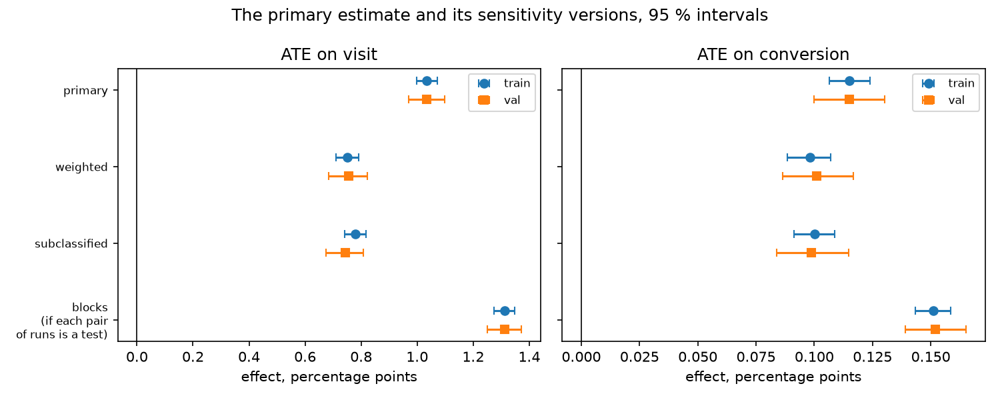
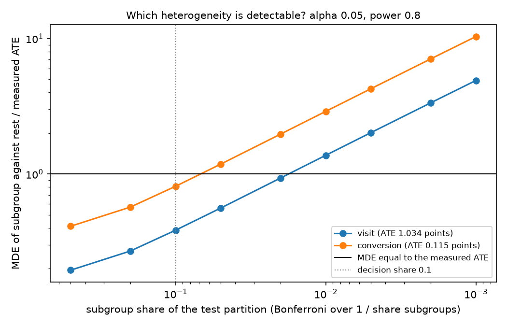

# Incremental Targeting

**Who should a campaign contact when the budget is fixed? The users it changes,
not the users most likely to convert.**

> **Status (October 2026): the average effect and the power analysis are
> measured; the simulation study, the learner selection and the test evaluation
> are under way.** Every setting is fixed in [`docs/design.md`](docs/design.md)
> and `config.py` before the result it governs, and the history shows it. A
> result that is not measured yet is blank, never filled from an expectation.

**Headline:** incremental conversions per 1,000 of budget, ranking by predicted
uplift against ranking by propensity to convert, on the held-out test
partition: **not measured yet**.

---

## The problem

A company can afford to contact `K` customers. The usual answer is to train a
classifier of conversion and contact the top `K` by score. That ranks the wrong
quantity.

| Segment | Converts if contacted | Converts if not | Worth contacting? |
|---|---|---|---|
| Persuadables | yes | no | **Yes. The only ones that matter.** |
| Sure things | yes | yes | No: they convert anyway |
| Lost causes | no | no | No |
| Sleeping dogs | no | yes | **No: contacting them loses the conversion** |

A propensity model puts the sure things at the top, because they are by
construction the most likely to convert, and the budget goes to people who would
have converted anyway. What should be ranked is the incremental effect of the
contact, the uplift:

$$\tau(x) = E[\,Y(1) - Y(0) \mid X = x\,].$$

**The thesis:** under a fixed budget, ranking by conversion probability instead
of incremental effect leaves conversions on the table. This project measures how
many, or shows with a calculation why they cannot be measured here.

## The data

[Criteo-UPLIFT v2.1](https://ailab.criteo.com/criteo-uplift-prediction-dataset/)
(Diemert et al., 2018): advertising incrementality tests in which users were
randomly assigned to be shown ads or not. As measured by the ingest
([`reports/data_summary.json`](reports/data_summary.json)), every figure matching
the published ones:

| | |
|---|---|
| Users | 13,979,592 |
| Features | 12, dense and anonymized (`f0` to `f11`) |
| Treated | 85.0 % |
| Visit rate | 4.70 % |
| Conversion rate | 0.29 % |

The file is downloaded from the `criteo` organization on Hugging Face, pinned to
a revision and checked against the SHA256 that its LFS pointer publishes; the
download link on the Criteo page no longer resolves. The data are licensed
CC BY-NC-SA 4.0 and are never committed here.

**Balance, checked before any effect**
([`reports/propensity_check.json`](reports/propensity_check.json)). The rule,
committed before the check ran, treats the propensity as constant unless the
lower bound of the 95 % interval of an out-of-sample AUC exceeds 0.51. A
classifier of the treatment on the features, fitted on train, scores 0.5102 on
validation (0.5093 to 0.5111): the lower bound is under the threshold and the
point estimate over it, so by the rule the primary analysis proceeds with a
constant propensity. The arms are not identical, though, and that is reported
with the same weight. The standardized mean differences are all below 0.05, but
5 to 50 times their noise level (about 0.001); and they imply a propensity that
varies by at least 0.68 points around 0.85 (a linear-projection bound whose noise
floor is 0.04 points), more than the 0.45 points the threshold was translated
into when it was fixed, a translation that assumed a normal spread. The figure
shows the skew: a tail of users assigned to the treatment more often. Every
effect will therefore be reported with sensitivity versions that use an
estimated propensity, declared before any effect was computed (`docs/design.md`
§6.5).


**Ties and repeated vectors** ([`reports/eda_summary.json`](reports/eda_summary.json)).
Storing the features as `float32` merges distinct source values in one feature
only: `f10` keeps 483,634 of its 517,372 values, and 80,469 rows (0.6 %) hold a
value that now shares its `float32` with another. The other eleven keep every
value; four of them take fewer than 300. A quarter of the rows (3,560,505) share
their whole twelve-feature vector with another row, in groups of up to 24, and
18.6 % of the validation and test rows have a vector that also appears in
train. The data cannot say whether those are repeated users or coarse features;
if they are repeated users, the evaluation on test is partly on users the models
have seen, and its figures lean optimistic.

## Key decisions

Each one is argued in `docs/design.md`.

1. **Intention to treat, and `exposure` is never a feature** (§3.3). `exposure`
   records whether the ad was actually displayed, which depends on the user's
   own browsing after assignment: only 3.6 % of the treated were exposed.
   Conditioning on it destroys the randomization. Models see the data only
   through one feature matrix, selected by name, and
   [`tests/test_no_exposure_leakage.py`](tests/test_no_exposure_leakage.py)
   checks that `exposure` cannot enter it.
2. **A random split, not a temporal one, and never by position** (§3.4, §4). A
   randomized experiment has no time axis. But the source file is sorted by
   treatment, in thirteen runs (the first is 5,571,799 treated users in a row),
   so a positional cut gives one-arm partitions and the row position predicts
   the treatment: `row_id` is kept out of the feature matrix by the same test,
   and any subset must be drawn by permutation, never as a contiguous slice.
   The split is random, stratified by treatment and both outcomes, 60/20/20,
   and the test partition is looked at once.
3. **Estimators validated against simulated truth before they touch real data**
   (§6). The error of an uplift model cannot be computed on real data, because a
   user's counterfactual is never observed. A Monte Carlo study over six regimes,
   where the truth is known, will measure each learner's error (PEHE) and predict
   which one should win on Criteo. On the real data the learner is chosen with
   the transformed outcome, on the validation partition only.
4. **Four meta-learners, each to be written by hand** (§5): S, T, X and a doubly
   robust learner with cross-fitting, all on LightGBM, so that the comparison is
   between meta-learners and not between base models.
5. **Every result with an error bar, every assumption fixed first** (§7 to §9).
   Each value in [`src/uplift/config.py`](src/uplift/config.py) is committed
   before any result that depends on it: the split, the propensity check, the
   effect estimates, the power analysis and its rule for the primary outcome,
   the simulation grid with its size, the learners' setting, the selection, the
   test evaluation, and the costs and budgets of the decision layer. The rule for
   the primary outcome, for one, was pushed while the ATE it compares against
   was still running. The budget-return curve will be published whole, including
   where uplift targeting does not win.

## Results

| Result | Value |
|---|---|
| Incremental conversions per 1,000 of budget, uplift against propensity ranking | not measured |
| PEHE of the four learners across six simulated regimes | not measured |
| Learner predicted by the simulation, and whether it won on Criteo | not measured |
| Power analysis: smallest detectable heterogeneity, per outcome | conversion: a decile against the rest, not a percentile; visit: down to 2 % subgroups |
| AUUC of the chosen learner, with its bootstrap interval | not measured |

### The average effect, and how much it depends on the propensity

([`reports/ate.json`](reports/ate.json)). Assignment to the campaign raises
visits by **1.03 points** (95 % interval 0.97 to 1.10 on validation; 3.82 % to
4.85 %) and conversions by **0.115 points** (0.100 to 0.130; 0.194 % to
0.309 %), a relative lift of 27 % and 59 %. The partitions agree by
construction (`docs/design.md` §4.2), and the bootstrap interval matches the
normal one.

The three sensitivity versions declared before this was computed (§6.5) do not
agree with it, and the gap is far larger than their noise. On visit, weighting
by a cross-fitted propensity gives 0.75 points and subclassifying by it 0.74:
about a quarter less, each with a paired interval of the difference that
excludes zero. Reading the file order as tests, the block version gives 1.31
points: about a quarter more. Conversion shows the same pattern, smaller below
and larger above (0.101, 0.099 and 0.152 points against 0.115). So the
propensity's small spread is not harmless. Correcting for it moves the effect on
visit by a quarter, which is what happens if the users the features mark as more
likely to be treated also visit more. The two corrections
that read the features agree with each other and disagree with the one that
reads the file order, which says that the features do not carry the tests the
way the blocks would, or that the reading of the runs as tests is wrong; the
source settles neither. By the rule fixed before the check, the primary
estimate stays the difference of means, and every effect below is read with
this range in mind.



### The primary outcome, decided by the power analysis

([`reports/power.json`](reports/power.json)). The rule, pushed while the ATE was
running (§8.3): an outcome supports heterogeneity at a subgroup size if a
subgroup whose effect differs from the rest's by as much as the average effect
would be detected with power 0.8, at a level divided by the number of such
subgroups, on the sample sizes of the test partition; `visit` stays primary
unless `conversion` supports deciles. It does: against the rest, a decile's
minimum detectable effect on conversion is 0.81 times the ATE, so **conversion,
the business metric, becomes the primary outcome**. The margin is not wide: a
subgroup of 5 % needs 1.18 times the ATE and a percentile 2.9 times, and with
the weighted or subclassified ATE the decile ratio would be 0.92 or 0.95.
Visit supports subgroups down to 2 % (0.93) and not percentiles (1.37).



**Written down before the results, on purpose.** If the effect is not
heterogeneous enough to rank by, that is the result: when uplift modeling is not
worth the budget, and how to know beforehand, with the power calculation that
shows it. If ranking by propensity turns out to be nearly as good, the result is
the map, from the simulation, of where that approximation holds and where it
breaks. In neither case are the budget, the costs or the thresholds moved until
the conclusion looks better.

## Limitations, known in advance

- The effect measured is that of being assigned to the campaign (intention to
  treat), diluted by the 96 % of treated users who never saw an ad. The effect on
  the exposed needs instrumental variables, and is out of scope.
- Fine heterogeneity on conversion, at a rate of 0.29 %, is not detectable at
  this sample size below subgroups of about 10 % (the power analysis above).
- The costs and the value of a conversion are assumptions, swept over ranges
  fixed in advance.
- 18.6 % of the test rows repeat a feature vector seen in train. If those are
  the same users, the test figures are partly in sample.
- The propensity is treated as constant by a rule fixed in advance, which it
  passed at the margin, while the features show a small but real spread (§6.4,
  §6.5). A check on the features can only refute a constant propensity, never
  confirm it (§2.3).

## Run it

```bash
uv sync --locked

# The suite, on synthetic data: no download, seconds.
make test
```

With the real data:

```bash
make data      # 311 MB, checksum verified, streamed into Parquet: the CSV never hits the disk
make split     # stratified train/validation/test, seed from config.py
make eda       # ties that float32 creates, and duplicated feature vectors
make propensity  # balance and propensity check, before any effect: about 3 minutes
make ate       # the ATE and its three sensitivity versions, with a cross-fitted propensity
make power     # the power analysis, which decides the primary outcome
make simulate  # the simulation study against known truth: hours, and it resumes if stopped
make select    # the four learners on train, one chosen on validation by the transformed outcome
make evaluate  # the test partition, opened once: uplift curves and the four targeting policies
make memory    # peak memory of each stage, with 2 threads
```

`make data` writes `reports/data_summary.json`, `make split` writes
`reports/split_summary.json`, `make eda` writes `reports/eda_summary.json`,
`make propensity` writes
`reports/propensity_check.json`, `make ate` writes `reports/ate.json` and
`make power` writes `reports/power.json`, each of the last three with its
figure. Every figure quoted in this
repository comes from one of those records, is derived from them by arithmetic,
or is quoted from the source, which is named.

## Repository structure

```
src/uplift/
├── config.py         # every value the analysis depends on, fixed before evaluation
├── features.py       # the feature matrix: f0 to f11, by name, never by exclusion
├── runinfo.py        # machine, versions and threads, recorded with every number
├── propensity_check.py  # the balance and propensity check, run before any effect
├── ate.py            # the ATE with its three sensitivity versions
├── power_analysis.py # the power analysis, which decides the primary outcome
├── select_learner.py # the learner chosen on validation
├── evaluate_test.py  # the test partition, opened once: curves and policies
├── learners/         # the S-, T-, X- and DR-learners, written by hand
├── simulate/         # the generator with known truth, and the simulation study
├── data/             # streaming ingest (CSV.gz to Parquet), stratified split, folds and subsamples
└── evaluate/         # evaluators: balance, propensity, effect estimators and power so far

tests/                # including the exposure leakage guard; all on synthetic data
scripts/              # checksum-verified download, peak memory probe
docs/design.md        # the specification: causal framework, estimators, validation
reports/              # the run records behind every quoted figure, and figures/
```

## License

Code: MIT. Data: Criteo-UPLIFT, CC BY-NC-SA 4.0, not redistributed. Cite it as
Diemert, E., Betlei, A., Renaudin, C. and Amini, M.-R. (2018). *A Large Scale
Benchmark for Uplift Modeling.* AdKDD and TargetAd Workshop, KDD.
